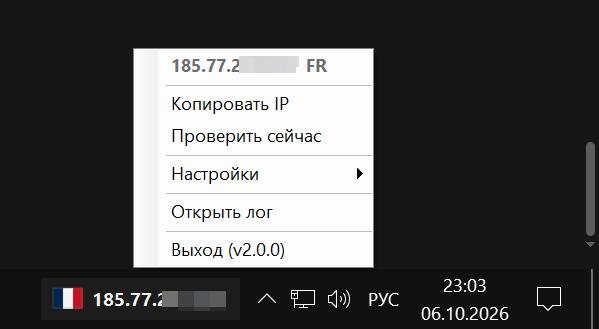

# InternetIPTaskbar

[](https://github.com/dakeending/InternetIPTaskbar/actions/workflows/ci.yml)
[](LICENSE)


**English** · [Русский](README.ru.md)

A tiny Windows utility that shows your **public IP address and the flag of the country** you are connecting from, right on the taskbar. It is built for checking that a VPN is really on, and it can warn you when the VPN drops.



## Features

- **"Flag + IP" window** next to the notification area (or centred on the taskbar). Click it to open the menu. It never steals focus and hides itself in full-screen games and videos.
- **Tray icon** with the flag; the tooltip shows IP, country and ISP. Double-click copies the IP.
- **Reliable detection:** two services are asked in parallel, a third only if they disagree. Country and ISP are looked up only when the IP changes.
- **Instant reaction to VPN changes:** the app listens for network events and re-checks right after a VPN is switched on or off (plus a regular interval: 1, 3, 5, 30 or 60 s).
- **VPN guard:** remember your real IP or country (with the VPN off). If you ever go online with it, the window turns red and a notification appears; an optional double steamship horn can sound too.
- **IPv6 leak hint:** shows your IPv6 address and warns when it comes from a different country than IPv4.
- **Honest failure states:** a stale IP is greyed out, and "no network" is shown instead of a misleading old address.
- **Per-monitor DPI, light/dark theme, any taskbar edge, auto-hide taskbar.**
- English and Russian interface (follows the Windows display language).

## Install

Download `InternetIPTaskbar_Setup_vX.Y.Z.exe` from the [Releases](https://github.com/dakeending/InternetIPTaskbar/releases) page and run it.

- No administrator rights needed; nothing else to install (the .NET runtime is bundled).
- The installer is **not code-signed**, so Windows SmartScreen may warn you: click *More info → Run anyway*. Compare the SHA-256 from the release page if you like.
- Requirements: Windows 10 (1607+) or Windows 11, 64-bit, internet access.

Uninstall from *Settings → Apps*, from the Start menu, or from the tray menu (*Settings → Uninstall…*).

## Usage

Right-click the tray icon (or click the IP window) to open the menu.

| Menu item | What it does |
|---|---|
| Copy IP / Copy IPv6 | Copies the address to the clipboard |
| Check now | Runs a check immediately |
| Settings → Check interval | 1, 3, 5, 30 or 60 seconds (default 30) |
| Settings → Position | Next to the notification area, or centred |
| Settings → VPN guard | Off / alert on real IP / alert on real country; remember or forget the real values |
| Settings → Horn on VPN alert | Double steamship horn on alarm (off by default) |
| Settings → Check IPv6 | Show IPv6 and warn about leaks |
| Settings → Start with Windows | Autostart on sign-in |
| Settings → Verbose log / Uninstall… | Diagnostics and removal |
| Open log | Opens `app.log` in Notepad |

Settings are stored in `%LOCALAPPDATA%\InternetIPTaskbar\settings.json`.

## Privacy

The app talks only to public lookup services: `api.ipify.org`, `ipv4.icanhazip.com`, `checkip.amazonaws.com`, `api6.ipify.org` (IPv6), `ipinfo.io`, `ipwho.is`, `ipapi.co` (geolocation) and `flagcdn.com` (flags, unless embedded). It sends no telemetry and has no account or server of its own. Your remembered "real" IP is stored only in `settings.json` on your computer. The log contains IP changes, so look at it before sharing.

## Build from source

Requirements: Windows, [.NET 8 SDK](https://dotnet.microsoft.com/download/dotnet/8.0), optionally [Inno Setup 6](https://jrsoftware.org/isinfo.php) for the installer.

```powershell
git clone https://github.com/dakeending/InternetIPTaskbar.git
cd InternetIPTaskbar
dotnet build -c Release
dotnet test -c Release
```

Make an installer (publishes a single-file self-contained exe first):

```powershell
.\scripts\fetch-flags.ps1      # optional: embed ~250 country flags into the exe
.\scripts\build-installer.ps1  # -> artifacts\InternetIPTaskbar_Setup_v<version>.exe
```

The version is set in one place: `<Version>` in `src/InternetIPTaskbar/InternetIPTaskbar.csproj`.

## Repository layout

```
src/InternetIPTaskbar/     application (WinForms, .NET 8)
tests/                     xUnit tests
installer/                 Inno Setup script
scripts/                   build, flags, icon and docs helpers
docs/                      architecture (Markdown, mermaid; Russian PDF)
.github/                   CI, release workflow, issue and PR templates
```

See [docs/ARCHITECTURE.md](docs/ARCHITECTURE.md) for how the pieces fit together.

## Contributing

Bug reports, ideas and pull requests are welcome - please read [CONTRIBUTING.md](CONTRIBUTING.md) and the [Code of Conduct](CODE_OF_CONDUCT.md). Translations are especially welcome: all UI text lives in [`Strings.cs`](src/InternetIPTaskbar/Strings.cs). For security issues see [SECURITY.md](SECURITY.md).

## License

[MIT](LICENSE) © 2026 dakeending. Third-party components and data sources are listed in [THIRD-PARTY-NOTICES.md](THIRD-PARTY-NOTICES.md).
