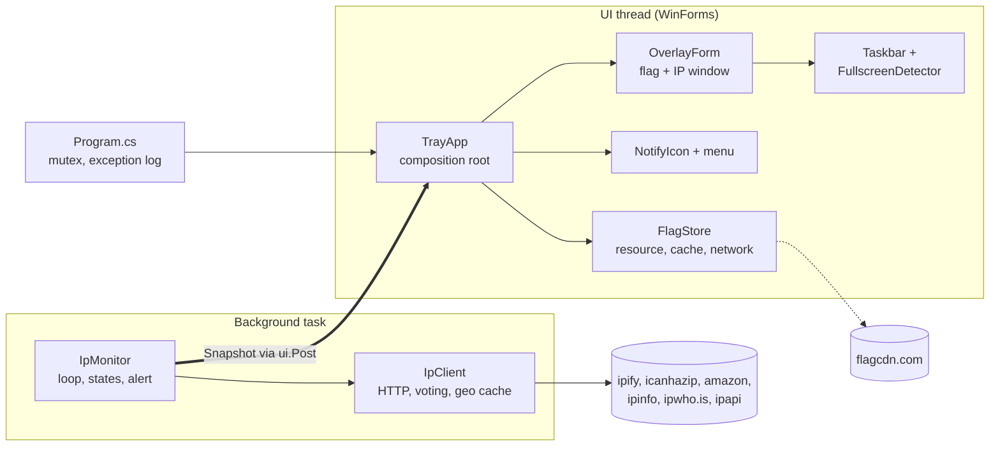
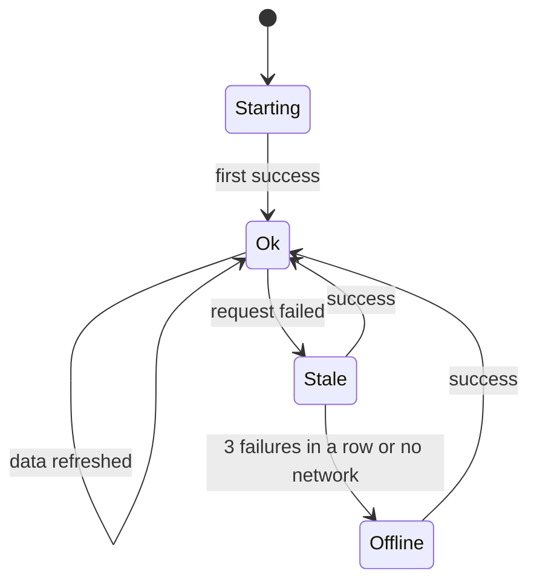
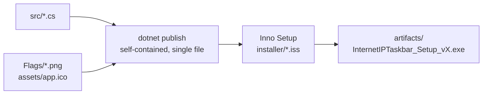

# Architecture

**English** · [Русский](ARCHITECTURE.ru.md) (with a PDF diagram pack)

InternetIPTaskbar is a WinForms application on .NET 8 with no main window. It is split into three parts: a **background network monitor**, an **immutable state snapshot**, and the **UI**. Everything runs in one process and lives in the system tray.

## Components



Cross-cutting modules: `Settings` (JSON), `Log` (rotating file), `AppInfo` (version, paths), `Strings` (UI text).

## Modules

| File (`src/InternetIPTaskbar/`) | Role |
|---|---|
| `Program.cs` | Entry point. Named mutex without a version number, unhandled-exception logging, starts `TrayApp`. |
| `TrayApp.cs` | Composition root. Creates settings, monitor, window and tray icon; receives `Snapshot` and distributes it; builds the menu, loads flags, shows notifications, plays the horn, handles autostart and uninstall. |
| `IpMonitor.cs` | The single source of truth about the network. Background loop, states `Starting / Ok / Stale / Offline`, alert and IPv6-mismatch evaluation, reaction to network events. |
| `IpClient.cs` | Static network layer: IPv4 from two services (a third on disagreement), IPv6, geolocation via ipinfo -> ipwho.is -> ipapi.co with a per-IP cache. |
| `FlagStore.cs` | Flag: embedded resource -> disk cache -> flagcdn.com. A corrupt cache file is deleted; only decodable images are cached. |
| `OverlayForm.cs` | Presentation only: flag (with a thin white outline) or country code, text, size and position, plate colour by state (green / grey / orange), and the 3 Hz, 10-second alert blink. Never takes focus; a click opens the menu. |
| `Taskbar.cs` | Taskbar position (any edge, auto-hide, notification area) and full-screen application detection. |
| `NativeMethods.cs` | P/Invoke declarations. |
| `Settings.cs`, `Log.cs`, `AppInfo.cs` | Settings JSON (atomic write), rotating log, version and paths. |
| `Autostart.cs`, `HornSound.cs` | Autostart via `HKCU\...\Run`; the double horn, synthesised into a WAV on first use. |
| `Strings.cs` | All user-visible text in English, Russian and Traditional Chinese (Hong Kong); the language follows Windows or is chosen in the menu. |
| `IpRange.cs` | IPv4 CIDR helpers: the /24 network of the remembered real IP and membership tests for the "real IP range" alert mode. |

## One check, end to end

```mermaid
sequenceDiagram
  participant T as Trigger
  participant M as IpMonitor
  participant C as IpClient
  participant A as TrayApp
  participant O as OverlayForm
  T->>M: timer, network event or "Check now"
  M->>C: GetIpv4Async
  C-->>M: IP (vote of 2-3 services)
  M-->>A: Snapshot (IP)
  A->>O: SetSnapshot / SetFlag
  M->>C: GetGeoAsync (only when the IP changed)
  C-->>M: country, ISP, city (cached)
  M->>C: GetIpv6Async (every 10 min or on a network event)
  M-->>A: Snapshot (country, IPv6)
  Note over A: on a country change the old flag is dropped and the new one loaded;<br/>on an alert: notification and (optionally) the horn
```

1. `IpMonitor` checks in the background. Triggers: the interval timer, `NetworkChange` events (a check 2 s and 8 s after a VPN is switched), "Check now", settings changes.
2. The result becomes an immutable `Snapshot`: IP, country/ISP/city, IPv6, state, alert flag, IPv6-mismatch flag.
3. `IpMonitor.Changed` is raised; `TrayApp` marshals the snapshot to the UI thread with `SynchronizationContext.Post`.
4. On the UI thread the window is repainted and the tray icon and tooltip are updated. When the country changes the old flag is removed immediately and the new one is loaded (the loaded image is discarded if the country changed again meanwhile).
5. A 1-second timer independently recomputes the window position, hides it for full-screen applications or a collapsed auto-hide taskbar, and raises it above the taskbar.

## Network states



| State | When | What the user sees |
|---|---|---|
| `Starting` | startup, no check completed yet | "…" |
| `Ok` | the last check succeeded | IP and flag |
| `Stale` | the request failed (1-2 times in a row) | the previous IP, greyed out |
| `Offline` | 3 failures in a row or the network is unavailable | "no network" |

After a failure the loop retries every 5 s instead of the normal interval. The **alert** is a separate flag on top of `Ok`/`Stale`: the IP, the IP range (/24 of the remembered IP) or the country equals the remembered "real" value, depending on the chosen mode. The plate blinks bright orange at 3 Hz for 10 seconds and then stays orange; a notification is shown and, if enabled, the horn plays.

Plate colours: **green** for `Ok` and `Stale` (the text is dimmed when stale), **grey** for `Starting` and `Offline`, **orange** on an alert.

## Design decisions

- **Threading.** State lives only in the background task; immutable `Snapshot` objects go out, so there is no locking in the UI. `Reevaluate()` recomputes the alert from the last snapshot without touching the network.
- **Load on third-party services.** A normal check is 2 requests. Country and ISP are looked up only when the IP changes (retried at most once a minute). IPv6 every 10 minutes or on network events. The IPv4 result is published before the IPv6 check so that a timeout never delays showing the address.
- **Resilience.** Every request uses a fresh connection (`Connection: close`); otherwise, after a VPN switch, a request could keep using the old route.
- **The window.** A regular `Form` with `WS_EX_NOACTIVATE | WS_EX_TOOLWINDOW`. While the menu is open the window is "paused" and not raised, so it cannot cover menu items. The menu is built before `Show()` because WinForms silently ignores an empty `ContextMenuStrip`.
- **Single instance.** The mutex name has no version, so two copies never run after an update.
- **No dependencies.** Only the .NET base class library and Windows Forms; no NuGet packages in the application.

## Build and delivery



- `InternetIPTaskbar.csproj`: the version in one place (`<Version>`), `PerMonitorV2`, single compressed self-contained exe, flags embedded from `Flags\*.png`.
- `installer/InternetIPTaskbar.iss`: version read from the exe, per-user install without admin rights, autostart via the registry, an uninstall shortcut, a prompt to delete user data on uninstall; English and Russian.
- `.github/workflows`: `ci.yml` (build, test, publish artifact), `release.yml` (tag -> installer + checksums -> GitHub release).
- Runtime data: `%LOCALAPPDATA%\InternetIPTaskbar` (`settings.json`, `logs\`, `flags-w80\`).

## Known limitations

- Only the primary taskbar is supported; Windows 11 and multi-monitor layouts are not verified.
- There are no UI automation tests; unit tests cover the logic that does not need a desktop.
- The installer is not code-signed, so SmartScreen and antivirus products may warn.
